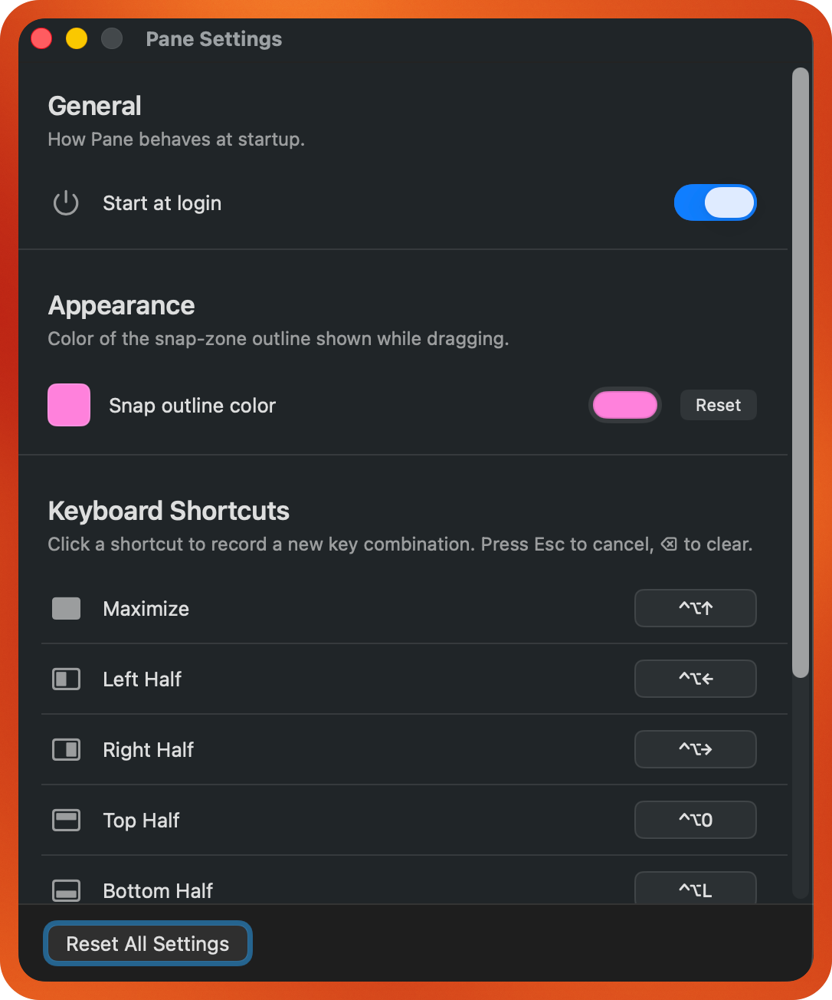

# Pane


A minimal macOS window-snapping utility. Lives in the menu bar, no Dock icon.

<p align="center">
  <video src="https://github.com/user-attachments/assets/6bcb637c-756d-4839-95ab-87b3d9ddfea3" width="720" controls muted></video>
</p>

## Two ways to snap

1. **Drag-to-edge** — grab any window's title bar and drag toward a screen edge or corner. The target zone outlines on-screen; release to snap.
   - Edge → corresponding half (top = maximize, bottom/left/right = bottom/left/right half)
   - Corner → that quarter of the screen
   - Drag in the middle of the screen → no outline, no snap (window moves freely)
2. **Keyboard shortcuts** — default modifier is `⌃⌥` (Control+Option), customizable in Settings:

   | Default | Action       |
   |---------|--------------|
   | `⌃⌥←`  | Left half     |
   | `⌃⌥→`  | Right half    |
   | `⌃⌥↑`  | Maximize      |
   | `⌃⌥O`  | Top half      |
   | `⌃⌥L`  | Bottom half   |
   | `⌃⌥U`  | Top-left      |
   | `⌃⌥I`  | Top-right     |
   | `⌃⌥J`  | Bottom-left   |
   | `⌃⌥K`  | Bottom-right  |

Open **Settings…** from the menu bar icon (or `⌘,`) to rebind any shortcut. Click a shortcut chip, press your new combo (must include at least one modifier). `Esc` cancels, `⌫` clears.

<p align="center">
  
</p>

## Download

Grab the latest `Pane-x.y.z.zip` from the [Releases page](https://github.com/hayatayubi/pane/releases/latest), unzip it, and drag `Pane.app` to `/Applications`.

Pane isn't signed with an Apple Developer ID (that costs $99/yr), so macOS Gatekeeper will refuse to open it on first launch. Two ways to clear that:

**One-liner (recommended):**

```bash
xattr -dr com.apple.quarantine /Applications/Pane.app && open /Applications/Pane.app
```

**Or, no terminal:** right-click `Pane.app` in `/Applications`, choose *Open*, then click *Open* in the warning dialog. After that one bypass, future launches work normally.

On first launch macOS will prompt for **Accessibility** permission. Grant it in *System Settings → Privacy & Security → Accessibility*, then relaunch.

## Build from source

```bash
./build.sh                              # local dev build (signed with your Apple Dev cert if you have one)
cp -R .build/release/Pane.app /Applications/    # first-time install
open /Applications/Pane.app
```

After the first install, subsequent `./build.sh` runs refresh `/Applications/Pane.app` automatically.

To produce a distributable release zip (ad-hoc signed, no Apple Dev cert required):

```bash
./build.sh --release    # outputs dist/Pane-<version>.zip
```

## Regenerating the icon

```bash
./tools/make-icon.sh
```

Edit [tools/IconGen.swift](tools/IconGen.swift) to change the design. The next `./build.sh` picks up the new `Resources/Pane.icns`.

## Requirements

- macOS 14 (Sonoma) or later
- Xcode 15+ / Swift 5.9+ toolchain

## Project layout

```
Sources/Pane/
  main.swift             – entry point
  AppDelegate.swift      – status item, permission flow, menu
  WindowManager.swift    – AX read/write + Electron compatibility
  ScreenCoords.swift     – AppKit ↔ AX coordinate helpers
  SnapZone.swift         – 9 snap targets, frame math, edge/corner triggers
  DragMonitor.swift      – CGEventTap + polling loop for drag detection
  SnapOverlay.swift      – full-screen zone-outline overlay
  HotkeyManager.swift    – Carbon RegisterEventHotKey bindings
  HotkeyBinding.swift    – binding model + UserDefaults store
  AppearanceStore.swift  – snap-outline color preference
  LaunchAtLoginStore.swift – SMAppService start-at-login wrapper
  SettingsWindow.swift   – SwiftUI settings UI + hotkey recorder

Resources/
  Pane.icns              – app icon (generated by tools/make-icon.sh)

tools/
  IconGen.swift          – CoreGraphics icon renderer
  make-icon.sh           – builds Pane.icns from the renderer
```
